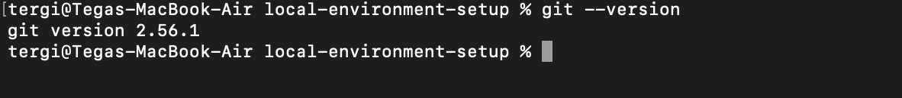
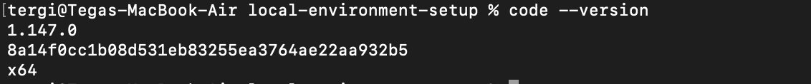
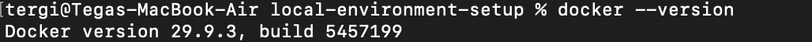
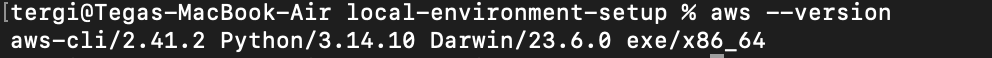
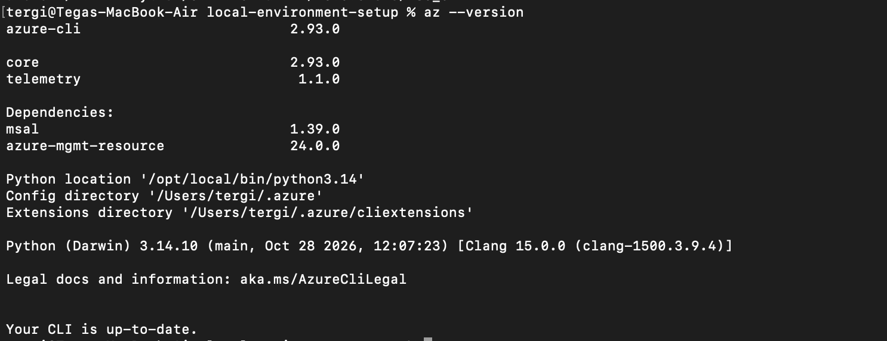
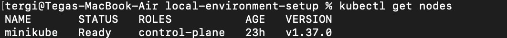
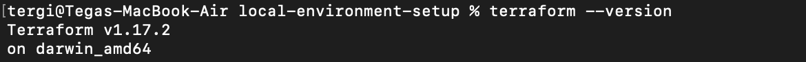
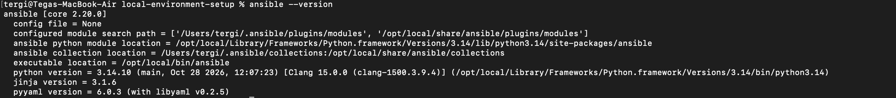

# DevOps Engineer Local Environment Setup

## Project Overview
This project documents the setup of a local DevOps development environment on an Intel-based Mac.

## System Specifications
- Operating System: macOS Sonoma 14.8.9
- Processor: Intel x86_64
- RAM: 8 GB
- Shell: Zsh
- Package Manager: MacPorts 2.12.7

## Development Tools
- Git: 2.39.5 (Apple Git)
- Visual Studio Code: 1.147.0
- Docker and Docker Compose: Pending
- Kubernetes (Minikube, kubectl, Helm): Pending
- AWS CLI and Azure CLI: Pending
- Node.js and jq: Pending
- Terraform and Ansible: Pending

## Installation Method
MacPorts was selected as the package manager after the current Homebrew installer rejected the Intel architecture.

## Verification
Tool versions and Kubernetes cluster status will be recorded in a verification report.

## Troubleshooting
The Homebrew installer returned an Apple Silicon-only error. MacPorts was installed successfully as an alternative.

## Project Status
Environment setup in progress.
## Installation and Configuration Evidence

The following screenshots demonstrate the installation and verification of the DevOps tools on my Intel-based macOS environment.

| Tool | Verification Screenshot |
|---|---|
| Git |  |
| Visual Studio Code |  |
| Docker |  |
| AWS CLI |  |
| Azure CLI |  |
| Kubernetes / Minikube |  |
| Terraform |  |
| Ansible |  |

### Environment Verification

I verified the installed tools using Terminal commands and recorded the results in `verification-report.txt`.

The project also includes `devops-env.sh`, which configures the local DevOps environment variables and command-line paths.

### Challenges and Troubleshooting

During setup, I encountered package installation errors, authentication issues when pushing to GitHub, and Kubernetes connection timeouts. I resolved these issues through alternative installation methods, GitHub token authentication, and Kubernetes configuration checks.